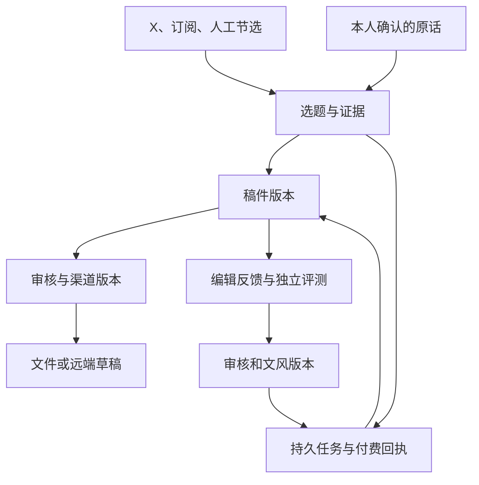

# 编辑部工作台 · 架构与数据责任

新仓库使用 React、Python 与关系数据库。产品验收以一篇文章从可核查的外部信源和作者原话，走到编辑确认的渠道产物，再以另一篇文章验证改稿经验为准。能够运行与能够生产上线分别验收。

编辑部是部署隔离单位，每人独立身份。共享编辑，作者确认权限绑定到原话本人，发布权止于外部草稿。生产数据库 PostgreSQL；SQLite 仅供单机试用。接入密钥按部署管理。业务源码、运行验证及技术限制以本仓库为准。
